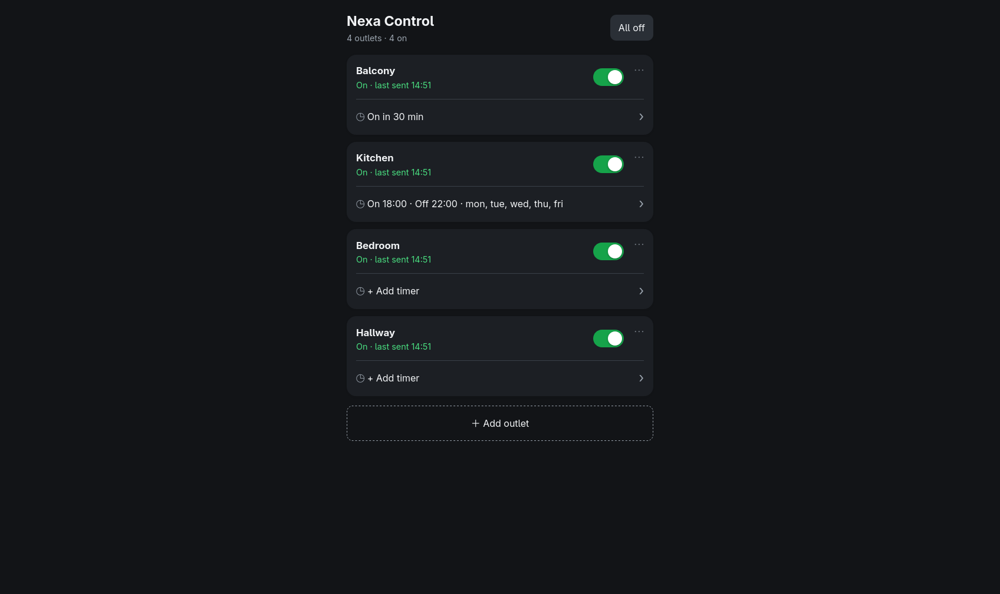
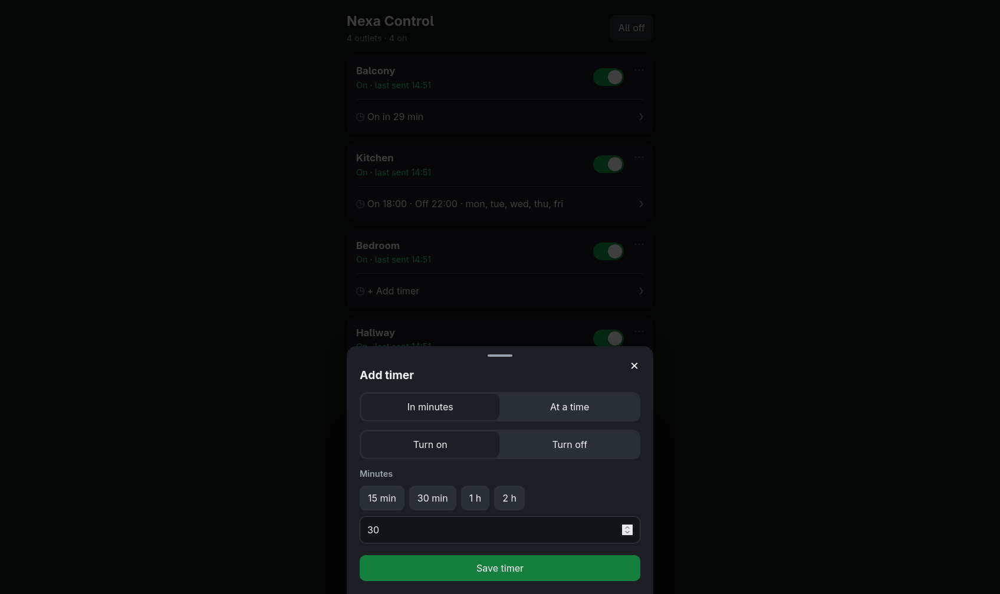

# Nexa Controller Pi

A small self-hosted web UI for controlling Nexa self-learning 433 MHz outlets from a Raspberry Pi 5, with countdowns and weekly schedules.

[![Last Commit][last-commit-shield]][last-commit-url]
[![Repo Size][repo-size-shield]][repo-size-url]
[![Build Status][build-shield]][build-url]
[![Test Coverage][coverage-shield]][coverage-url]
[![Author][author-shield]][author-url]

# Index

1. [About the project](#about-the-project)
1. [Features](#features)
1. [Built with](#built-with)
1. [Getting started](#getting-started)
1. [Configuration](#configuration)
1. [Scripts](#scripts)
1. [Testing](#testing)
1. [Code analysis](#code-analysis)
1. [Deployment](#deployment)
1. [Troubleshooting](#troubleshooting)
1. [Contributing](#contributing)
1. [Authors](#authors)

# About the project

Nexa Controller Pi lets you switch Nexa self-learning outlets from your phone or laptop without the original remote. A cheap 433 MHz transmitter module is wired to a Raspberry Pi 5, and a Python/Flask app generates the Nexa signal directly on a GPIO pin and serves a simple web page on your local network.

Nexa radio is one-way, but the app can listen for commands with a 433 MHz receiver and update the displayed state when a physical remote or another transmitter is used.

This repository contains **only the controller app**. It requires a 433 MHz ASK/OOK transmitter module (FS1000A type) wired to the Pi, and outlets that support Nexa's self-learning protocol.

## Built with

![Python][tech-1-shield]
![Flask][tech-2-shield]
![Docker][tech-3-shield]
![Raspberry Pi][tech-4-shield]

## Features

- Switch outlets on and off from any device on your network
- Pair new outlets from the web page ("Add outlet")
- "All off" button
- Countdown timers ("turn off in 30 minutes")
- Weekly schedules (time + days), which can be disabled or deleted
- Timers, outlets and last-known states are saved to disk and survive restarts
- Runs directly with Python or as a Docker container
- Docker runs with Gunicorn as the production WSGI server
- Login protection with Argon2id password hashing and CSRF-protected sessions

## Screenshots

| Dashboard | Timers |
|---|---|
|  |  |

# Getting started

## Prerequisites

- Raspberry Pi 5 running Raspberry Pi OS (Bookworm or newer)
- A 433 MHz transmitter module and a 433 MHz receiver module
- About 17 cm of solid wire for the antenna, soldered to the module's ANT pad
- Nexa self-learning outlets
- Python 3 with Flask, Flask-WTF, lgpio and python-dotenv, or Docker

## Wiring

Power off the Pi before connecting anything.

| Transmitter pin | Pi 5 physical pin | Description |
|---|---|---|
| VCC | Pin 2 | 5 V |
| GND | Pin 6 | Ground |
| DATA | Pin 11 | GPIO17 |

Connect the receiver DATA output to physical pin 13 (BCM GPIO27). The receiver
is started automatically when the app runs in hardware mode.

Check the labels printed on your module, because the pin order can vary between batches.

## Installation

```sh
# Generate a password hash (run locally, then put the output in .env)
python3 -m pip install argon2-cffi
python3 -c "from argon2 import PasswordHasher; print(PasswordHasher().hash(input('Password: ')))"
```

Create a `.env` file:

```env
SECRET_KEY=replace-with-a-long-random-secret
AUTH_USERNAME=admin
AUTH_PASSWORD_HASH=replace-with-the-generated-argon2id-hash
COOKIE_SECURE=true
```

For Portainer stacks, use Base64 to avoid `$` interpolation in Argon2 hashes:

```sh
python3 -c "import base64; print(base64.b64encode(input('Hash: ').encode()).decode())"
```

Set the generated value as `AUTH_PASSWORD_HASH_B64` and remove
`AUTH_PASSWORD_HASH`. The Base64 value contains no `$` characters.

For Portainer, the simplest option is to set the plaintext password directly
as an environment variable. It contains no `$` interpolation-sensitive hash:

```env
AUTH_USERNAME=admin
AUTH_PASSWORD=choose-a-long-unique-password
```

The application hashes this password with Argon2id in memory when it starts;
the plaintext is not written to the data directory. Remove
`AUTH_PASSWORD_HASH`, `AUTH_PASSWORD_HASH_B64`, and
`AUTH_PASSWORD_HASH_FILE` when using `AUTH_PASSWORD`.

Then install and run:

```sh
# Clone the repository
git clone https://github.com/erikpersson0884/smart-socket-controller.git

# Navigate into the project directory
cd smart-socket-controller

# Install dependencies
sudo apt update
sudo apt install python3-flask python3-lgpio python3-dotenv
python3 -m pip install --user Flask-WTF argon2-cffi

# Find the GPIO chip number of the Pi's header (look for pinctrl-rp1)
gpiodetect

# Start the app
python3 webui.py
```

The app runs on `http://127.0.0.1:8080` by default. To access it from another device on the network, set `HOST=0.0.0.0` in `.env`, then open `http://<pi-ip>:8080` (or `http://raspberrypi.local:8080`). Edit `CHIP` at the top of `webui.py` if `gpiodetect` shows a different number than 15.

## Pairing outlets

1. Open the web page and press **Add outlet**.
2. Give the outlet a name and confirm.
3. Put the outlet in learning mode (plug it in, or hold its button until the LED blinks) before confirming.
4. The app sends an "on" command with the next free unit number (0-15), and the outlet remembers it.

Pair one outlet at a time. Up to 16 outlets are supported per transmitter ID.

# Configuration

Create a `.env` file in the project directory for required secrets and local overrides.

| Variable | Default | Description |
|---|---|---|
| `PORT` | `8080` | Port the web UI listens on |
| `HOST` | `127.0.0.1` | Network interface to bind to. Use `0.0.0.0` only when the app must be reachable from other devices |
| `DATA_DIR` | project `data/` folder (`/data` in Docker) | Where `nexa_state.json`, `nexa_devices.json` and `nexa_timers.json` are stored |
| `GPIO_MODE` | `hardware` | Set to `mock` on a development computer without GPIO hardware. Pairing and switching are simulated |
| `GPIO_CHIP` | `15` | GPIO chip number for the Pi header (`pinctrl-rp1` on the default setup) |
| `TX_PIN` | `17` | BCM GPIO output connected to the transmitter DATA pin (physical pin 11) |
| `RX_PIN` | `27` | BCM GPIO input connected to the receiver DATA output (physical pin 13) |
| `TZ` | system time zone | Time zone used by schedules (set it in Docker) |
| `SECRET_KEY` | required | Stable random secret used to sign sessions and CSRF tokens |
| `AUTH_USERNAME` | `admin` | Username required to sign in |
| `AUTH_PASSWORD` | unset | Plaintext startup password; hashed in memory with Argon2id, useful for Portainer |
| `AUTH_PASSWORD_HASH` | unset | Argon2id hash of the login password |
| `AUTH_PASSWORD_HASH_B64` | unset | Base64-encoded Argon2id hash; recommended for Portainer stacks |
| `COOKIE_SECURE` | `false` | Set to `true` when the app is served over HTTPS |

Hardware settings can be overridden with environment variables:

| Variable | Default | Description |
|---|---|---|
| `GPIO_CHIP` | `15` | GPIO chip of the Pi's header (`pinctrl-rp1` in `gpiodetect`) |
| `TX_PIN` | `17` | BCM GPIO number the transmitter DATA pin is wired to |
| `RX_PIN` | `27` | BCM GPIO number the receiver DATA pin is wired to |
| `REPEAT` | `6` | How many times each command is sent |

# Scripts

| Command | What it does |
|---|---|
| `python3 webui.py` | Start the web UI |
| `python3 -m unittest discover -s tests -v` | Run the test suite |
| `python3 -m coverage run -m unittest discover -s tests && python3 -m coverage report` | Run tests and print a coverage report |
| `docker compose up --build` | Build and start the container |
| `docker compose logs -f` | Follow the container logs |
| `docker compose down` | Stop the container |


# Testing

Tests use Python's built-in `unittest` framework and are located in `tests/`. They cover the web UI, favicon and logo assets, device listing, outlet switching, pairing, countdowns, schedules, and API validation.

```sh
python3 -m unittest discover -s tests -v
```

To measure coverage, install the optional `coverage` package and run:

```sh
python3 -m pip install coverage
python3 -m coverage run -m unittest discover -s tests
python3 -m coverage report
```

The tests mock radio transmission and file persistence where needed, so they can run without a Raspberry Pi or connected outlet.

# Code analysis

The project can optionally be analyzed with SonarQube. This requires access to your own server, so it is not part of the normal setup.

1. Create a project in SonarQube and generate an access token.
2. Set the server details as environment variables:

   ```sh
   export SONAR_HOST_URL=http://your-server:9000
   export SONAR_TOKEN=your_token
   ```

3. Make sure the project key in `sonar-project.properties` matches your project, or override it:

   ```sh
   sonar-scanner -Dsonar.projectKey=your-project-key
   ```

4. Generate coverage, then run the analysis:

   ```sh
   python3 -m coverage run -m unittest discover -s tests
   python3 -m coverage xml
   sonar-scanner
   ```

Never commit your token.

# Deployment

The repository includes a `Dockerfile` and a `docker-compose.yml`.

```sh
docker compose up --build
```

The app is then available on `http://<pi-ip>:8080` (host port 8080 maps to port 8080 in the container).

**Requirements at runtime:** the container must run on the same Pi the transmitter is wired to, and `/dev/gpiochip15` must exist on the host.

## How it is configured

- **GPIO access:** the container gets only the GPIO chip device (`/dev/gpiochip15`) instead of full privileged mode. Update the `devices:` line if `gpiodetect` shows a different number.
- **Persistence:** `DATA_DIR=/data` is mounted from `./data`, so outlets, timers and states survive rebuilds.
- **Time zone:** schedules use the container's clock, so set `TZ` in `docker-compose.yml`.
- **Portainer:** build the image on the Pi (`docker build -t nexa-web:latest .`) and use the compose file as a stack, or deploy the stack from the Git repository.

# Troubleshooting

| Problem | What to try |
|---|---|
| `GPIO error` on start | Run `gpiodetect` and set `CHIP` to the number next to `pinctrl-rp1`. In Docker, update the `devices:` mapping too |
| Permission error | Run with `sudo`, or `sudo usermod -aG gpio $USER` and log in again |
| Outlet does nothing | Test within a metre, check the antenna is straight and soldered, and try another transmitter module |
| On and off are swapped | Swap `"1"` and `"0"` in the `bits` line in `transmit()` |
| Outlet stopped responding | It may have forgotten its pairing. Put it in learning mode and send "on" again |
| Schedules fire at the wrong time | Check the clock with `date` and set the time zone (`timedatectl`, or `TZ` in Docker) |

**Security:** the page has no login. Keep it on your home network and do not forward the port on your router.

# Contributing

If you want to contribute, follow these steps:

1. Fork the repository
2. Create a new branch (`git checkout -b feature-branch`)
3. Make your changes and run the test suite. Test hardware changes against a real outlet
4. Commit your changes (`git commit -m 'Add new feature'`)
5. Push to the branch (`git push origin feature-branch`)
6. Create a Pull Request

# Authors

<p align="center">
  
  <br />
  <strong><a href="https://github.com/erikpersson0884">Erik Persson</a></strong><br />
  Creator &amp; Maintainer
</p>


<!-- Repo info shields -->
[last-commit-shield]: https://img.shields.io/github/last-commit/erikpersson0884/smart-socket-controller/main?style=for-the-badge&cacheSeconds=30
[last-commit-url]: https://github.com/erikpersson0884/smart-socket-controller/commits/main

[repo-size-shield]: https://img.shields.io/github/repo-size/erikpersson0884/smart-socket-controller?style=for-the-badge&cacheSeconds=60
[repo-size-url]: https://github.com/erikpersson0884/smart-socket-controller

[author-shield]: https://img.shields.io/badge/Author-Erik-purple?style=for-the-badge
[author-url]: https://github.com/erikpersson0884

[build-shield]: https://img.shields.io/github/actions/workflow/status/erikpersson0884/smart-socket-controller/build-and-push.yml?branch=main&style=for-the-badge
[build-url]: https://github.com/erikpersson0884/smart-socket-controller/actions

<!-- Test coverage shield (requires a workflow that writes .github/coverage.json to a "coverage" branch) -->
[coverage-shield]: https://img.shields.io/endpoint?url=https://raw.githubusercontent.com/erikpersson0884/smart-socket-controller/coverage/.github/coverage.json&style=for-the-badge&v=2
[coverage-url]: https://github.com/erikpersson0884/smart-socket-controller/actions


<!-- Tech stack shields -->
[tech-1-shield]: https://img.shields.io/badge/Python-3776AB?logo=python&logoColor=white&style=for-the-badge
[tech-2-shield]: https://img.shields.io/badge/Flask-000000?logo=flask&logoColor=white&style=for-the-badge
[tech-3-shield]: https://img.shields.io/badge/Docker-2496ED?logo=docker&logoColor=white&style=for-the-badge
[tech-4-shield]: https://img.shields.io/badge/Raspberry%20Pi-A22846?logo=raspberrypi&logoColor=white&style=for-the-badge
