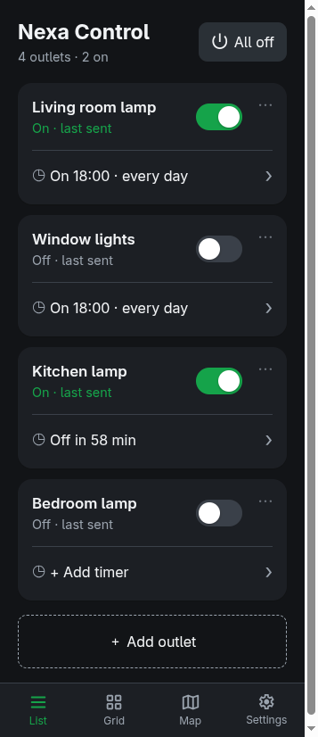
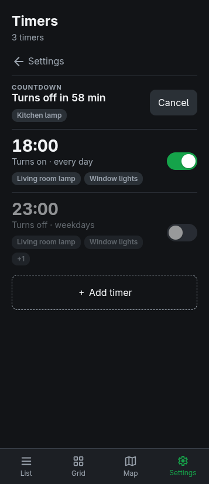
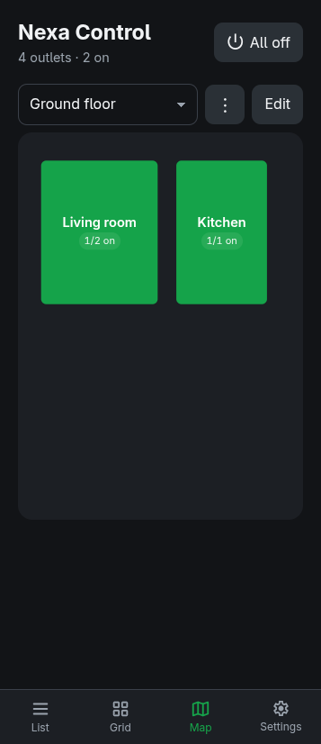
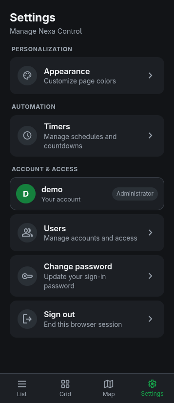

<h1 align="center">Nexa Controller Pi</h1>

<p align="center">
  A self-hosted controller for Nexa 433 MHz outlets, with rooms, countdowns, and weekly schedules.
</p>

<p align="center">
  <a href="#features">Features</a> ·
  <a href="#screenshots">Screenshots</a> ·
  <a href="#getting-started">Getting started</a> ·
  <a href="#deployment">Docker</a> ·
  <a href="#api-key-access">API</a> ·
  <a href="#testing">Testing</a>
</p>

<div align="center">

[![Last Commit][last-commit-shield]][last-commit-url]
[![Repo Size][repo-size-shield]][repo-size-url]
[![Build Status][build-shield]][build-url]
[![Test Coverage][coverage-shield]][coverage-url]
[![Author][author-shield]][author-url]

![Python][tech-1-shield]
![Flask][tech-2-shield]
![Docker][tech-3-shield]
![Raspberry Pi][tech-4-shield]

</div>


# Index

1. [About the project](#about-the-project)
1. [Features](#features)
1. [Built with](#built-with)
1. [Getting started](#getting-started)
1. [Configuration](#configuration)
1. [Scripts](#scripts)
1. [Testing](#testing)
1. [Code analysis](#code-analysis)
1. [Deployment](#deployment)
1. [Troubleshooting](#troubleshooting)
1. [Contributing](#contributing)
1. [Authors](#authors)

# About the project

Nexa Controller Pi lets you switch Nexa self-learning outlets from your phone or laptop without the original remote. A cheap 433 MHz transmitter module is wired to a Raspberry Pi 5, and a Python/Flask app generates the Nexa signal directly on a GPIO pin and serves a simple web page on your local network.

Nexa radio is one-way, but the app can listen for commands with a 433 MHz receiver and update the displayed state when a physical remote or another transmitter is used.

Enable **Tools** under Settings → Appearance → Footer views, then open Tools → Receiver to see the latest 50 received commands. You can also visit `/receiver-log` while signed in. The page refreshes every 5 seconds; the log is held in memory and resets when the app restarts.
Individual commands show the currently configured outlet name for the received unit and the controller's transmitter ID. A group command is applied to all configured outlets; the raw unit is shown for diagnostics.

The development launcher adds example receiver log entries on startup without changing outlet state.

This repository contains **only the controller app**. It requires a 433 MHz ASK/OOK transmitter module (FS1000A type) wired to the Pi, and outlets that support Nexa's self-learning protocol.

## Built with

Built with Python, Flask, Docker, and Raspberry Pi.

## Features

- Switch outlets on and off from any device on your network
- Pair new outlets from the web page ("Add outlet")
- Choose an outlet number when pairing and change it later from the outlet edit menu
- "All off" button (double-press within 400 ms to turn all outlets on instead)
- Map view: draw rooms on multiple floors, assign outlets to each room, then tap a room to switch its outlets. Existing maps become the Ground floor
- Countdown timers ("turn off in 30 minutes")
- Weekly schedules (time + days), which can be disabled or deleted
- Timers, outlets and last-known states are saved to disk and survive restarts
- Runs directly with Python or as a Docker container
- Docker runs with Gunicorn as the production WSGI server
- Login protection with username/password authentication and CSRF-protected sessions
- Optional Bearer API key for trusted services that need to control the outlets

## Screenshots

| Dashboard | Timers |
|---|---|
|  |  |

| Map | Settings |
|---|---|
|  |  |

# Getting started

## Prerequisites

- Raspberry Pi 5 running Raspberry Pi OS (Bookworm or newer)
- A 433 MHz transmitter module and a 433 MHz receiver module
- About 17 cm of solid wire for the antenna, soldered to the module's ANT pad
- Nexa self-learning outlets
- Python 3 with Flask, Flask-WTF, lgpio and python-dotenv, or Docker

## Wiring

Power off the Pi before connecting anything.

| Transmitter pin | Pi 5 physical pin | Description |
|---|---|---|
| VCC | Pin 2 | 5 V |
| GND | Pin 6 | Ground |
| DATA | Pin 11 | GPIO17 |

Connect the receiver DATA output to physical pin 13 (BCM GPIO27). The receiver
is started automatically when the app runs in hardware mode.

Check the labels printed on your module, because the pin order can vary between batches.

## Installation

```sh
Create a `.env` file:

```env
SECRET_KEY=replace-with-a-long-random-secret
AUTH_USERNAME=admin
AUTH_PASSWORD=choose-a-long-unique-password
COOKIE_SECURE=true
```

Then install and run:

```sh
# Clone the repository
git clone https://github.com/erikpersson0884/nexa-pi-controller.git

# Navigate into the project directory
cd nexa-pi-controller

# Install dependencies
python3 -m pip install -r requirements.txt

# Find the GPIO chip number of the Pi's header (look for pinctrl-rp1)
gpiodetect

# Start the app
python3 -m nexa_pi_controller
```

The app runs on `http://127.0.0.1:8080` by default. To access it from another device on the network, set `HOST=0.0.0.0` in `.env`, then open `http://<pi-ip>:8080` (or `http://raspberrypi.local:8080`). Set `GPIO_CHIP` in `.env` if `gpiodetect` shows a different number than 15.

## Development with example data

After installing the Python dependencies and configuring `SECRET_KEY`,
`AUTH_USERNAME`, and `AUTH_PASSWORD` in `.env`, start the development instance:

```sh
python3 -m nexa_pi_controller.dev
```

This uses mock GPIO and stores its data and separate account database in
`.dev-data/`, regardless of `DATA_DIR`. On the first run it creates example
outlets, states, schedules, a one-hour countdown, floors, and rooms. Subsequent
runs keep your changes; if any controller data file already exists, seeding is
skipped. The countdown expires normally and the enabled schedule runs with mock
radio commands. The first administrator is bootstrapped from the configured
credentials as usual.

On the first development startup, four additional accounts are created:
`demo-admin-1`, `demo-admin-2`, `demo-operator-1`, and `demo-operator-2`.
Each receives a randomly generated password printed once in the startup
terminal. `demo-admin-1` and `demo-operator-1` must change their temporary
passwords at first login; `demo-admin-2` and `demo-operator-2` can sign in
without changing theirs. Keep the terminal output private. Existing accounts
with those names are not changed, and sample accounts are not recreated on
later starts, so the password-change setting applies only when an account is
first seeded. The configured bootstrap administrator can reset their passwords
if needed. These accounts are only for development; keep the development
server private.

To seed again, stop the development instance and remove only
`.dev-data/nexa_devices.json`, `.dev-data/nexa_state.json`,
`.dev-data/nexa_timers.json`, and `.dev-data/nexa_rooms.json`, then restart it.
This keeps the development accounts intact. Never point a production instance
at `.dev-data/`.

## Pairing outlets

1. Open the web page and press **Add outlet**.
2. Give the outlet a name and confirm.
3. Put the outlet in learning mode (plug it in, or hold its button until the LED blinks) before confirming.
4. The app sends an "on" command with the next free unit number (0-15), and the outlet remembers it.

Pair one outlet at a time. Up to 16 outlets are supported per transmitter ID.

# Configuration

Create a `.env` file in the project directory for required secrets and local overrides.

| Variable | Default | Description |
|---|---|---|
| `PORT` | `8080` | Port the web UI listens on |
| `HOST` | `127.0.0.1` | Network interface to bind to. Use `0.0.0.0` only when the app must be reachable from other devices |
| `DATA_DIR` | project `data/` folder (`/data` in Docker) | Where controller state, map data, and the `nexa_users.sqlite3` account database are stored |
| `GPIO_MODE` | `hardware` | Set to `mock` on a development computer without GPIO hardware. Pairing and switching are simulated |
| `LG_WD` | private temporary directory | Optional lgpio working directory. If set, it must exist, be writable, and be protected from other users; lgpio changes the process working directory to this location |
| `GPIO_CHIP` | `15` | GPIO chip number for the Pi header (`pinctrl-rp1` on the default setup) |
| `TX_PIN` | `17` | BCM GPIO output connected to the transmitter DATA pin (physical pin 11) |
| `RX_PIN` | `27` | BCM GPIO input connected to the receiver DATA output (physical pin 13) |
| `TX_ID` | `12345678` | Nexa transmitter ID used when sending and filtering received commands |
| `T` | `260e-6` | Base radio pulse duration in seconds |
| `REPEAT` | `6` | Number of times each radio command is sent |
| `TZ` | system time zone | Time zone used by schedules (set it in Docker) |
| `SECRET_KEY` | required | Stable random secret used to sign sessions and CSRF tokens |
| `AUTH_USERNAME` | `admin` | Username imported as the first administrator when the account database is initialized |
| `AUTH_PASSWORD` | unset | Password imported for the first administrator; required for initial account setup |
| `API_KEY` | unset | Optional shared Bearer token for API access; unset disables API-key access |
| `COOKIE_SECURE` | `false` | Set to `true` when the app is served over HTTPS |
| `SESSION_LIFETIME_DAYS` | `7` | How many days a login stays valid after your last activity |

### User accounts

New accounts see an optional welcome wizard after signing in and completing
any required password change. It offers language, theme, view, and outlet
pairing choices. Wizard completion is saved per account; language, theme, and
view remain specific to the browser. Existing accounts are not shown the wizard.

On the first launch, Nexa Control imports `AUTH_USERNAME` and `AUTH_PASSWORD`
as the initial administrator and stores the password as a hash in
`nexa_users.sqlite3` under `DATA_DIR`. Keep the account database with the rest
of the persistent data. After this one-time import, changing those environment
variables does not change account credentials; administrators can manage users
from **Settings → Users**.

All users can change their own username or password from **Settings → Your
account**. Changing your username requires your current password.
Administrators can create other administrators or operators, change their
usernames, activate or deactivate accounts, and issue temporary passwords.
Username changes preserve existing sessions; the new username is used at sign-in.
Passwords must be at
least 6 characters. Users must choose a new password before accessing the app.
Operators can use the controller but cannot manage accounts. The shared
`API_KEY` continues to authorize its existing API
operations and does not grant account-management access.

### API key access

Set `API_KEY` in `.env` to a long, random secret. Generate one with:

```sh
python3 -c "import secrets; print(secrets.token_urlsafe(32))"
```

Services can then call the same API endpoints using an HTTP Bearer token, for example:

```sh
curl -X POST http://raspberrypi:8080/api/0/on \
  -H "Authorization: Bearer YOUR_API_KEY"
```

The initial API key grants the same access as a logged-in user, including switching outlets and managing configuration and timers. Keep it secret, and only expose the app over a trusted network or HTTPS. API permissions and separately managed keys can be added later.

Hardware settings can be overridden with environment variables:

| Variable | Default | Description |
|---|---|---|
| `GPIO_CHIP` | `15` | GPIO chip of the Pi's header (`pinctrl-rp1` in `gpiodetect`) |
| `TX_PIN` | `17` | BCM GPIO number the transmitter DATA pin is wired to |
| `RX_PIN` | `27` | BCM GPIO number the receiver DATA pin is wired to |
| `TX_ID` | `12345678` | Nexa transmitter ID used for radio commands |
| `T` | `260e-6` | Base pulse duration in seconds used to encode radio commands |
| `REPEAT` | `6` | How many times each command is sent |

# Scripts

| Command | What it does |
|---|---|
| `python3 -m nexa_pi_controller` | Start the web UI |
| `PYTHONPATH=. python3 -m unittest discover -s tests -v` | Run the test suite |
| `npm test` | Run browser-code and service worker tests (Node.js 22+) |
| `npm run test:coverage` | Run JavaScript tests and generate an LCOV report for `app.js` |
| `PYTHONPATH=. python3 -m coverage run --source=nexa_pi_controller -m unittest discover -s tests && python3 -m coverage report` | Run tests and print a coverage report |
| `docker compose up --build` | Build and start the container |
| `docker compose logs -f` | Follow the container logs |
| `docker compose down` | Stop the container |


# Testing

Tests use Python's built-in `unittest` framework and are located in `tests/`. They cover the web UI and API, persistence, timer scheduling, radio transmission, and receiver decoding. GPIO operations are mocked, so no Raspberry Pi hardware is required.

```sh
PYTHONPATH=. python3 -m unittest discover -s tests -v
```

JavaScript tests use Node.js 22 or newer and jsdom to exercise the page without GPIO hardware. Install the test dependencies and run them with:

```sh
npm ci
npm test
npm run test:coverage
```

JavaScript coverage is reported in the terminal and written to `coverage/lcov.info`. The coverage badge tracks Python only; the SonarQube workflow imports both Python and JavaScript reports.

To measure Python coverage, run:

```sh
PYTHONPATH=. python3 -m coverage run --source=nexa_pi_controller -m unittest discover -s tests
python3 -m coverage report
```

The tests mock radio transmission and file persistence where needed, so they can run without a Raspberry Pi or connected outlet.

# Code analysis

The project can optionally be analyzed with SonarQube. This requires access to your own server, so it is not part of the normal setup.

1. Create a project in SonarQube and generate an access token.
2. Set the server details as environment variables:

   ```sh
   export SONAR_HOST_URL=http://your-server:9000
   export SONAR_TOKEN=your_token
   ```

3. Use the project key configured in the SonarQube workflow, or override it:

   ```sh
   sonar-scanner -Dsonar.projectKey=your-project-key
   ```

4. Generate coverage, then run the analysis:

   ```sh
   PYTHONPATH=. python3 -m coverage run --source=nexa_pi_controller -m unittest discover -s tests
   python3 -m coverage xml
   npm ci
   npm run test:coverage
   sonar-scanner -Dsonar.sources=nexa_pi_controller -Dsonar.tests=tests \
     -Dsonar.python.coverage.reportPaths=coverage.xml \
     -Dsonar.javascript.lcov.reportPaths=coverage/lcov.info \
     -Dsonar.exclusions=node_modules/**,coverage/**
   ```

Never commit your token.

# Deployment

The repository includes a `Dockerfile` and a `docker-compose.yml`.

```sh
docker compose up --build
```

The app is then available on `http://<pi-ip>:8080` (host port 8080 maps to port 8080 in the container).

**Requirements at runtime:** the container must run on the same Pi the transmitter is wired to, and `/dev/gpiochip15` must exist on the host.

## How it is configured

- **GPIO access:** the container gets only the GPIO chip device (`/dev/gpiochip15`) instead of full privileged mode. Update the `devices:` line if `gpiodetect` shows a different number.
- **Persistence:** `DATA_DIR=/data` is mounted from `./data`, so outlets, timers and states survive rebuilds.
- **Time zone:** schedules use the container's clock, so set `TZ` in `docker-compose.yml`.
- **Portainer:** build the image on the Pi (`docker build -t nexa-web:latest .`) and use the compose file as a stack, or deploy the stack from the Git repository.

# Troubleshooting

| Problem | What to try |
|---|---|
| `GPIO error` on start | Run `gpiodetect` and set `CHIP` to the number next to `pinctrl-rp1`. In Docker, update the `devices:` mapping too |
| Permission error | Run with `sudo`, or `sudo usermod -aG gpio $USER` and log in again |
| Outlet does nothing | Test within a metre, check the antenna is straight and soldered, and try another transmitter module |
| On and off are swapped | Swap `"1"` and `"0"` in the `bits` line in `transmit()` |
| Outlet stopped responding | It may have forgotten its pairing. Put it in learning mode and send "on" again |
| Schedules fire at the wrong time | Check the clock with `date` and set the time zone (`timedatectl`, or `TZ` in Docker) |

**Security:** the page has no login. Keep it on your home network and do not forward the port on your router.

# Contributing

If you want to contribute, follow these steps:

1. Fork the repository
2. Create a new branch (`git checkout -b feature-branch`)
3. Make your changes and run the test suite. Test hardware changes against a real outlet
4. Commit your changes (`git commit -m 'Add new feature'`)
5. Push to the branch (`git push origin feature-branch`)
6. Create a Pull Request

# Authors

<p align="center">
  
  <br />
  <strong><a href="https://github.com/erikpersson0884">Erik Persson</a></strong><br />
  Creator &amp; Maintainer
</p>


<!-- Repo info shields -->
[last-commit-shield]: https://img.shields.io/github/last-commit/erikpersson0884/nexa-pi-controller/main?style=for-the-badge&cacheSeconds=30
[last-commit-url]: https://github.com/erikpersson0884/nexa-pi-controller/commits/main

[repo-size-shield]: https://img.shields.io/github/repo-size/erikpersson0884/nexa-pi-controller?style=for-the-badge&cacheSeconds=60
[repo-size-url]: https://github.com/erikpersson0884/nexa-pi-controller

[author-shield]: https://img.shields.io/badge/Author-Erik-purple?style=for-the-badge
[author-url]: https://github.com/erikpersson0884

[build-shield]: https://img.shields.io/github/actions/workflow/status/erikpersson0884/nexa-pi-controller/build-and-push.yml?branch=main&style=for-the-badge
[build-url]: https://github.com/erikpersson0884/nexa-pi-controller/actions

<!-- Test coverage shield (requires a workflow that writes .github/coverage.json to a "coverage" branch) -->
[coverage-shield]: https://img.shields.io/endpoint?url=https://raw.githubusercontent.com/erikpersson0884/nexa-pi-controller/coverage/.github/coverage.json&style=for-the-badge&v=2
[coverage-url]: https://github.com/erikpersson0884/nexa-pi-controller/actions


<!-- Tech stack shields -->
[tech-1-shield]: https://img.shields.io/badge/Python-3776AB?logo=python&logoColor=white&style=for-the-badge
[tech-2-shield]: https://img.shields.io/badge/Flask-000000?logo=flask&logoColor=white&style=for-the-badge
[tech-3-shield]: https://img.shields.io/badge/Docker-2496ED?logo=docker&logoColor=white&style=for-the-badge
[tech-4-shield]: https://img.shields.io/badge/Raspberry%20Pi-A22846?logo=raspberrypi&logoColor=white&style=for-the-badge
